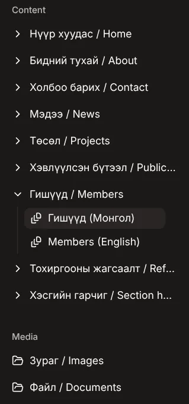
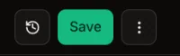
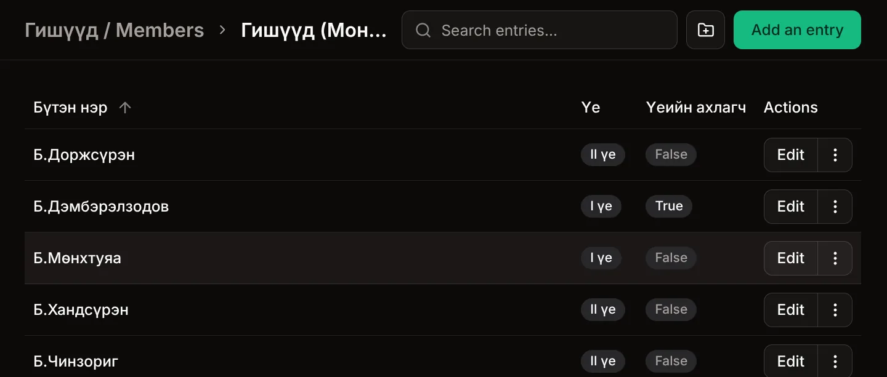
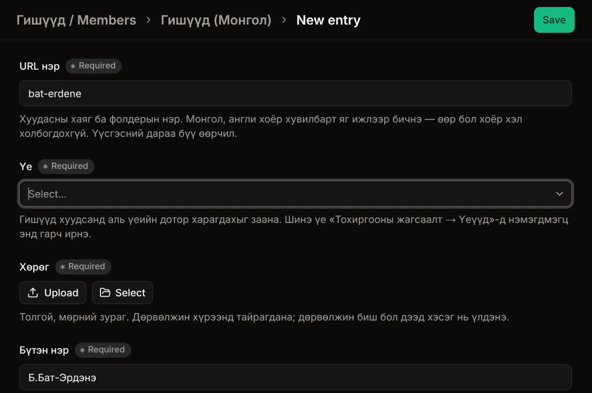
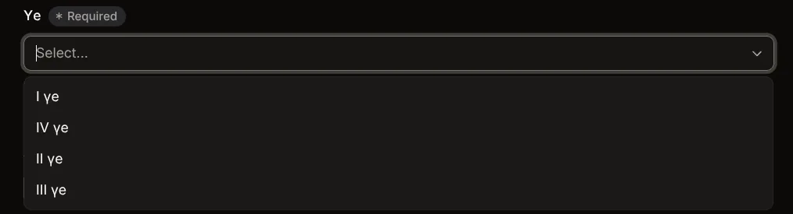
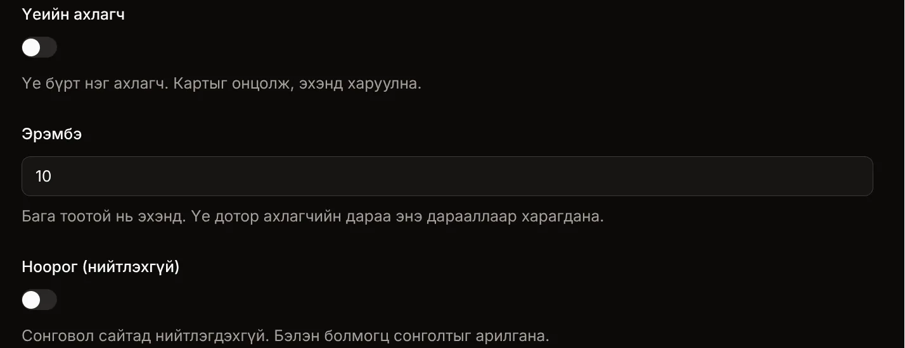
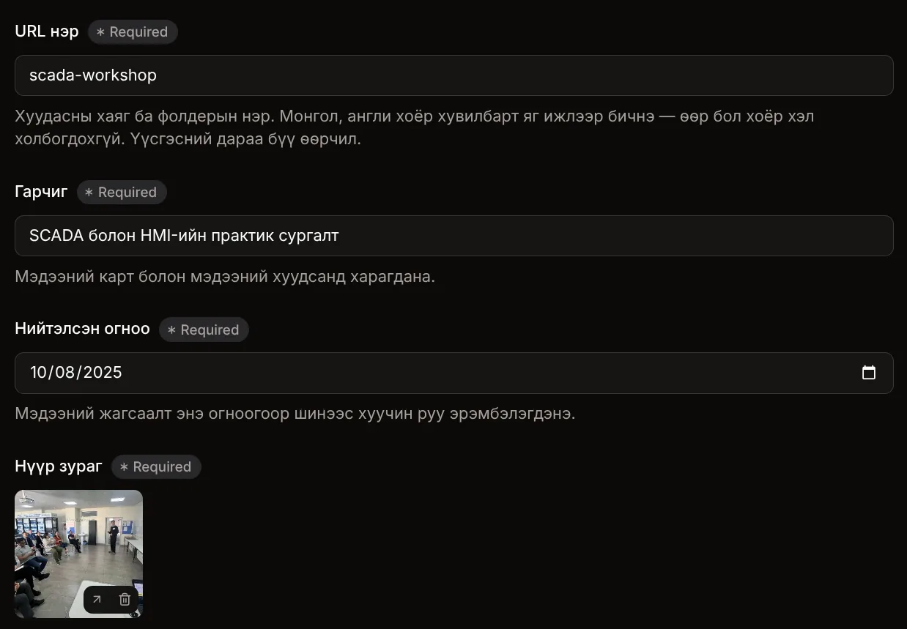
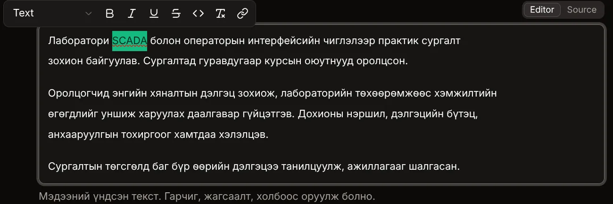
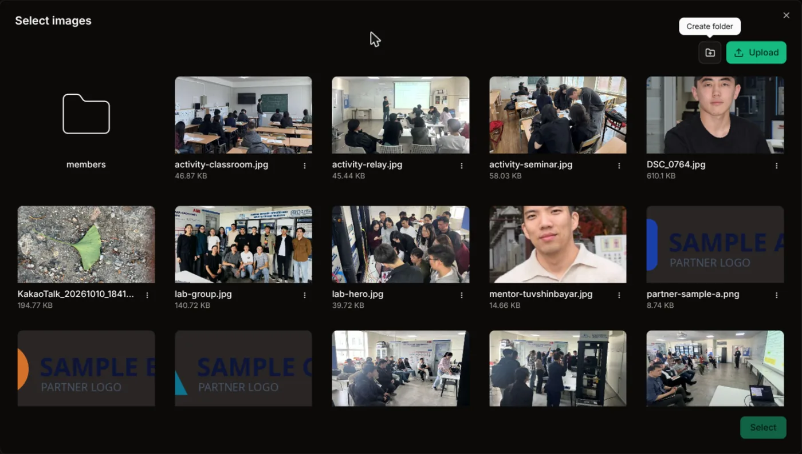

+++
title = "Сайт засах заавар"
summary = "EPA-Lab сайтын агуулгыг Pages CMS-ээр нэмж, засах алхам алхмаар заавар. Код мэдэх шаардлагагүй."
# Editors reach this page by its link only: it stays out of the menu, page
# lists, RSS, the sitemap and search results.
noindex = true
[build]
  list = "never"
[sitemap]
  disable = true
# Screenshots go in this folder beside this file and are placed with
#  under the step they illustrate.
+++

## Эхлэхийн өмнө

Сайтын бүх текст, зургийг **Pages CMS** гэдэг вэб програмаар засна. Маягт бөглөөд **Save** дарахад л болно, код мэдэх шаардлагагүй.

Дөрвөн зүйлийг санаарай:

1. **Save дарах нь нийтлэх гэсэн үг.** Тусдаа «нийтлэх» товч байхгүй. Хадгалснаас хойш хэдэн минутын дотор өөрчлөлт [epalab.mn](https://epalab.mn) дээр гарна.
2. **Мэдээ, төсөл, бүтээл, гишүүн бүр хоёр хэлтэй.** Монгол, англи хувилбарыг тус тусад нь оруулна.
3. **Талбар бүрийн доор саарал тайлбар бий.** Тухайн талбар сайтын хаана харагдах, юу бичихийг тэндээс уншина.
4. **Алдаа гаргахаас бүү ай.** Өөрчлөлт бүрийн түүх хадгалагддаг тул буруу засвар, устгасан зүйлийг сэргээж болно.

## Нэвтрэх

1. [app.pagescms.org](https://app.pagescms.org) руу орно.
2. Лабораторийн имэйл хаягаа оруулна. Хандах эрх энэ хаяг дээр олгогдсон.
3. Имэйлд ирсэн холбоос дээр дарна.
4. Жагсаалтаас **epa**-г сонгоно.

## Цэс

Зүүн талын цэс сайтын хуудсуудтай ижил. Цэсний нэр дээр дарахад доор нь **(Монгол)**, **(English)** гэсэн хоёр хувилбар нээгдэнэ.

| Цэс | Юу засах |
|---|---|
| Нүүр хуудас | Нүүр гарчиг, зураг, зорилго, тоон үзүүлэлт, хамтрагч байгууллага |
| Бидний тухай | Лабораторийн түүх, амжилт, удирдагч багш |
| Холбоо барих | Хаяг, имэйл, сошиал хаяг |
| Мэдээ | Мэдээ, үйл явдал |
| Төсөл | Лабораторийн төслүүд |
| Хэвлүүлсэн бүтээл | Өгүүлэл, илтгэл |
| Гишүүд | Лабораторийн гишүүд |
| Тохиргооны жагсаалт | Гишүүдийн үеүүд |
| Хэсгийн гарчиг | Мэдээ, Төсөл, Бүтээл, Гишүүд хуудасны дээд талын гарчиг |
| Зураг, Файл | Оруулсан бүх зураг, PDF |

## Хадгалах

Засвар бүрийн дараа баруун дээд буланд байгаа ногоон **Save** товчийг дарна. Дарахгүйгээр өөр хуудас руу шилжвэл засвар алга болно.

## Гишүүн нэмэх

1. Цэснээс **Гишүүд / Members → Гишүүд (Монгол)**-г сонгоно. Бүх гишүүний жагсаалт гарна.
2. Баруун дээд буланд байгаа ногоон **Add an entry** товчийг дарна.

3. Маягтыг бөглөнө:
   - **URL нэр** — гишүүний нэрийг латинаар, жижиг үсгээр. Жишээ: `bat-erdene`. Энэ нэрийг англи хувилбарт яг ижлээр бичнэ.
   - **Үе** — жагсаалтаас гишүүний үеийг сонгоно.
   - **Хөрөг** — **Upload** дарж компьютерээсээ зураг оруулна, эсвэл **Select** дарж өмнө оруулсан зургаас сонгоно.
   - **Бүтэн нэр**, **Хөтөлбөр**, **Курс** — сайтад яг бичсэнээр харагдана.

4. Доош гүйлгээд үлдсэн талбаруудыг шаардлагатай бол бөглөнө. Ихэнхийг нь хоосон эсвэл байгаагаар нь үлдээж болно.
   - **Үеийн ахлагч** — зөвхөн тухайн үеийн ахлагчид асаана.
   - **Эрэмбэ** — үе доторх дараалал. Мэдэхгүй бол `10` хэвээр үлдээнэ.

5. **Save** дарна.
6. Одоо англи хувилбар: цэснээс **Members (English)**-г сонгоод 2–5-р алхмыг давтана. **URL нэр**-ийг монгол хувилбартай яг ижил бичиж, нэр, хөтөлбөр, курсийг англиар бичнэ.

Гишүүн төгсвөл устгахгүй: гишүүнийг нээгээд **Төгсөгч**-ийг асааж, **Төгссөн он**-ыг бичээд **Save** дарна. Монгол, англи хоёуланд нь хийнэ.

## Мэдээ нэмэх

1. Цэснээс **Мэдээ / News → Мэдээ (Монгол)**-г сонгоод **Add an entry** дарна.
2. Маягтыг бөглөнө:
   - **URL нэр** — мэдээний товч нэр латинаар. Жишээ: `scada-workshop`.
   - **Гарчиг**, **Нийтэлсэн огноо**.
   - **Нүүр зураг** — хэвтээ зураг сонгоно.
   - **Товч агуулга** — 1–2 өгүүлбэр. Мэдээний картанд харагдана.

3. **Агуулга** талбарт мэдээний үндсэн текстийг бичнэ. Word шиг ажилладаг: текстээ сонгоход тод болгох, жагсаалт, холбоос нэмэх товчнууд гарна.

4. Нүүр хуудсанд гаргах бол **Нүүр хуудсанд харуулах**-ыг асаана.
5. **Save** дарна.
6. **News (English)**-д ижил URL нэртэйгээр англи хувилбарыг нэмнэ.

## Төсөл нэмэх

Мэдээтэй ижил: **Төсөл / Projects → Төсөл (Монгол)** → **Add an entry**. Хоёр зүйлд анхаарна:

- **Зорилго**, **Үр дүн** талбарт жагсаалт бичих бол мөр бүрийг зураас, хоосон зайгаар (`- `) эхлүүлнэ.
- **Холбогдох бүтээл**-ээс сонгох бүтээл эхлээд **Хэвлүүлсэн бүтээл**-д нэмэгдсэн байх ёстой.

Дараа нь **Projects (English)**-д англи хувилбарыг нэмнэ.

## Бүтээл нэмэх

**Хэвлүүлсэн бүтээл / Publications → Бүтээл (Монгол)** → **Add an entry**. Нэр, он, сарыг бичээд PDF файл оруулна, эсвэл сэтгүүл, хурлын хуудасны холбоосыг **Гадаад холбоос**-д бичнэ. PDF-ийг зөвхөн нийтлэхийг зөвшөөрсөн бол оруулна. Дараа нь англи хувилбарыг нэмнэ.

## Зураг оруулах

Зургийн талбарт **Upload** дарвал компьютерээсээ шинэ зураг оруулна. **Select** дарвал өмнө оруулсан зургийн сангаас сонгоно: зураг дээр дараад доод талын **Select** товчийг дарна.

- JPG, PNG, WEBP зураг 5 МБ-аас бага байвал зүгээр. Утсаар авсан зураг ихэвчлэн болно.
- Оруулахаас өмнө файлын нэрийг латинаар өөрчилнө. Жишээ: `bat-erdene.jpg`, `scada-workshop-1.jpg`. «Screenshot 2026-10-19…» гэх мэт нэр дараа нь олоход хэцүү.
- Хүн орсон зургийг тэдний зөвшөөрөлтэйгөөр оруулна.

## Засах, нуух, устгах

- **Засах:** жагсаалтаас **Edit** дарж өөрчлөөд **Save** дарна.
- **Түр нуух:** **Ноорог (нийтлэхгүй)**-ийг асаагаад **Save** дарна. Сайтаас алга болох боловч CMS-д хадгалагдсаар байна. Бэлэн болмогц унтраагаад дахин **Save** дарна.
- **Устгах:** ихэнхдээ нуух нь хангалттай. Устгах шаардлагатай бол надад хэлээрэй.

## Шинэ үе нэмэх

1. **Тохиргооны жагсаалт → Үеүүд** → **Add an entry**.
2. Түлхүүр (жишээ нь `fifth-generation`), дараалал (өмнөх үеэс 10-аар их тоо), монгол, англи нэр, гарчгийг бөглөөд **Save** дарна.
3. Шинэ үе гишүүний **Үе** жагсаалтад шууд гарч ирнэ.

Нүүр хуудас хамгийн шинэ үеийг харуулдаг. Үе нэмсэн даруйдаа тэр үеийн гишүүдийг нэмээрэй, эс бөгөөс нүүр хуудсанд хоосон хэсэг харагдана.

## Хийж болохгүй зүйлс

- **URL нэрийг дараа нь солих.** Хуудасны хаяг өөрчлөгдөж, хуучин холбоосууд ажиллахаа болино.
- **Add an entry-ийн хажуугийн хавтасны товчийг дарах.** Хавтас үүсгэх шаардлага байхгүй.
- **Хуудсанд ашиглагдаж байгаа зургийг «Зураг»-аас устгах.** Тэр хуудас эвдэрнэ.
- **Нэг зүйлийг хоёр хүн зэрэг засах.** Нэгнийх нь өөрчлөлт хадгалагдахгүй байж болно.
- **Хувийн мэдээлэл оруулах.** Хувийн утас, гэрийн хаяг зэргийг сайтад бүү тавь.

## Асуудал гарвал

1. **Өөрчлөлт сайтад харагдахгүй байна:** 5 минут хүлээгээд хуудсаа шинэчилнэ. Компьютер дээр **Ctrl + Shift + R**, утсан дээр хуудсаа хаагаад дахин нээнэ.
2. **Англи сайтад харагдахгүй байна:** англи хувилбар нэмэгдсэн эсэх, URL нэр нь монгол хувилбартай яг ижил эсэхийг шалгана.
3. **Бусад бүх асуудал:** [mendbayar45@gmail.com](mailto:mendbayar45@gmail.com) руу юу хийх гэж байснаа бичиж, дэлгэцийн зургийг хавсаргана.
